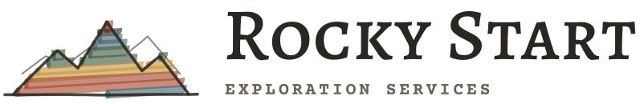
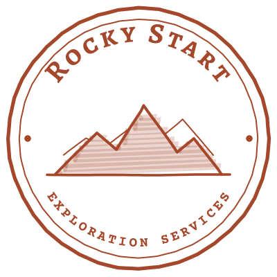

# Rocky Start Exploration Services: Design System



The brand for Rocky Start Exploration Services, a field-geology and mineral-exploration services company. It should feel like a well-kept field book: weathered cream paper, typewritten records, neat notes in the margin, and colours from a long day on an outcrop.

**Motto:** *Geology starts, and ends, in the rocks.*

## What's here

| Folder | Contents |
| --- | --- |
| [`logos/`](logos) | Finished logo files (SVG, lettering converted to shapes), each in a light and dark version |
| [`fonts/`](fonts) | Alegreya SC (500, 700) and Courier Prime (400, 700), with their SIL Open Font Licences |
| [`tokens/`](tokens) | `tokens.json` (every colour, type style, spacing, radius, roughness and opacity value) and `tokens.css` (the same as CSS custom properties) |
| [`docs/`](docs) | [Brand guide](docs/brand-guide.md), [logo guidelines](docs/logo-guidelines.md), and [`cover.html`](docs/cover.html), the brand cover artwork as a standalone page |

## Logos

| File | What it is | Use for |
| --- | --- | --- |
| `rocky-start-lockup-light.svg` / `-dark.svg` | Primary logo: three-peak mountain mark beside the name | Report covers, website header, proposals, signage |
| `rocky-start-mark-light.svg` / `-dark.svg` | The mountain mark on its own | Where the name already appears nearby |
| `rocky-start-seal-light.svg` / `-dark.svg` | Round survey seal, one colour | Letterhead, core-box labels, sample bags, invoices, watermarks |
| `rocky-start-rs-light.svg` / `-dark.svg` | RS mark | Favicons, avatars, app icons, anything under 40px |

Use `-light` files on cream paper and `-dark` files on dark backgrounds. Minimum sizes, clear space and don'ts are in the [logo guidelines](docs/logo-guidelines.md).

<p>
  
  &nbsp;&nbsp;
  
</p>

## Colour

| Colour | Light | Dark | Role |
| --- | --- | --- | --- |
| Paper | `#f4ede0` | `#1c1915` | Page background |
| Paper raised | `#ebe1cf` | `#26221d` | Cards, table headers, sidebars |
| Ink | `#2a2622` | `#efe7da` | Body text and headings |
| Ink muted | `#6b6157` | `#b3a796` | Captions, metadata, units |
| Line | `#cbbfa9` | `#3d362e` | Hairline rules, gridlines |
| Rust | `#a4472a` | `#d9774f` | Brand colour: key actions, links, key figures; errors |
| Pine | `#3e5b3f` | `#8fb08a` | Secondary accent, success |
| Ochre | `#c8963e` | `#d8a952` | Highlights, warnings, chart fills (never as text on paper) |
| Ink on ochre | `#2a2622` | `#1c1915` | Text on an ochre fill |
| Slate | `#486572` | `#8fb0bd` | Info states, water in figures |
| Sage | `#c9cfb4` | `#3a4034` | Quiet tint behind notes or selected rows |

## Typography

- **Alegreya SC** for titles, headings and the logo name. Write headings in sentence case; lowercase sets as small caps.
- **Courier Prime** for body text, data and labels.
- **Kalam** for handwritten margin notes and figure annotations only (loaded from [Google Fonts](https://fonts.google.com/specimen/Kalam)).

## Using the tokens on a web page

```html
<link rel="stylesheet" href="tokens/tokens.css">
<body style="background: var(--paper); color: var(--ink); font-family: var(--font-typewriter);">
  <h1 class="display">Drill program summary</h1>
  <p class="body">Core recovered at 94% through the skarn interval.</p>
</body>
```

Add `data-theme="dark"` to `<html>` for the dark theme.

The full guidance on voice, layout, and the hand-drawn marker-and-pencil style is in the [brand guide](docs/brand-guide.md).
